# CP5 — Análisis académico y paquete para el Capítulo IV

## 1. Propósito

CP5 transforma la evidencia técnica validada en CP3–CP4 en hallazgos interpretables para el segundo avance. El objetivo no es enumerar catorce pruebas, sino explicar qué demuestran en conjunto, qué no demuestran, cómo se relacionan con la hipótesis del primer avance y qué controles deben preservarse, fortalecerse o verificarse.

La rúbrica del Avance 2 exige presentar resultados de procedimientos/experimentos o simulaciones, demostrar aplicación de contenidos del curso y proponer una solución al caso. Este paquete organiza la evidencia para cumplir esas tres funciones sin trasladar toda la data cruda al cuerpo del artículo.

## 2. Lectura global de la campaña

La campaña ejecutó 14 casos definidos antes de observar los resultados. Se registraron 16 runs porque T001 y T013 se repitieron como controles después de reinicios/sesiones distintas. Trece casos produjeron observaciones válidas y T010 quedó indeterminado porque el servicio SSH previsto en RADIUS no pudo verificarse.

Nueve casos cumplen la condición estricta P=C=O. Cuatro casos válidos —T001, T006, T009 y T013— tienen P=O pero conservan C=unknown. Esta distinción es metodológicamente importante: la configuración estática disponible no permitía predecir de forma completa la conectividad extremo a extremo, pero la ejecución sí permitió observarla. T010 no se reinterpreta como deny; se mantiene como limitación.

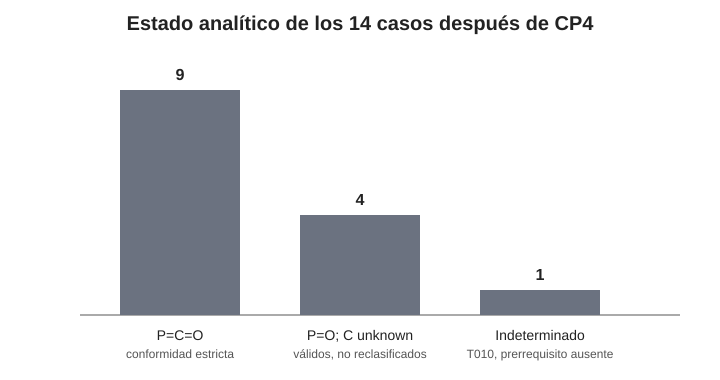

**Fig. 4.** Estado analítico de los 14 casos después de CP4. El 69,23 % corresponde a conformidad estricta P=C=O entre casos válidos; no es un porcentaje de seguridad.

Por zona de origen, Guest Wi-Fi concentra seis pruebas, Corp Wi-Fi tres, Management dos y Hospitalstaff tres. La distribución no pretende representar estadísticamente todas las comunicaciones del hospital; responde a una selección intencional de rutas de alto valor para comprobar aislamiento, privilegios y controles positivos.

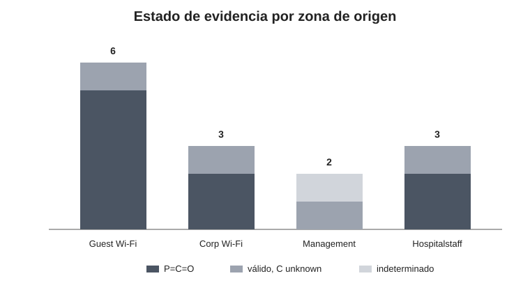

**Fig. 5.** Estado de evidencia por zona de origen. Los segmentos con C=unknown no se consideran fallos; representan flujos permitidos cuya predicción estática permaneció incompleta.

## 3. Aislamiento de la red de invitados: servicio útil sin confianza interna

El primer patrón relevante aparece en Guest Wi-Fi. T001 demostró que el cliente de invitados podía alcanzar el host externo, mientras T002, T003, T004, T005 y T014 no completaron intercambio con Internal Server, Management, RADIUS, Corp Wi-Fi y WLC respectivamente.

Este conjunto debe interpretarse como una unidad. Un ping bloqueado, aislado, podría deberse a un endpoint inactivo, una ruta rota o un problema general de conectividad. En cambio, T001 funciona como control positivo del origen; otros controles verifican destinos específicos. El patrón observado es por tanto compatible con una red de visitantes que conserva su función principal —conectividad externa— mientras limita rutas hacia zonas de mayor confianza.

La evidencia de T002–T005 tiene causalidad strongly_supported porque el resultado coincide con las ACL observadas, el routing conocido y los controles positivos. No se eleva a confirmed porque no existe una traza PDU o delta de contadores suficientemente fiable que identifique una regla exacta. T014 es todavía más conservador: demuestra que Guest no completó la sesión HTTPS hacia el WLC y que el mismo WLC respondió desde Management, pero el punto concreto de descarte no fue observado; su causalidad permanece possible.

Este resultado aplica directamente conceptos de segmentación, VLAN, ACL y control de flujo de la arquitectura de red. NIST recomienda separar y administrar las WLAN de acuerdo con políticas organizacionales y mantener configuraciones coherentes durante su ciclo de vida [3]. En este escenario, esa separación no es teórica: los flujos seleccionados muestran un límite funcional entre el servicio para visitantes y la infraestructura interna.

### Evidencia visual recomendada

| Control positivo | Aislamiento |
|---|---|
| 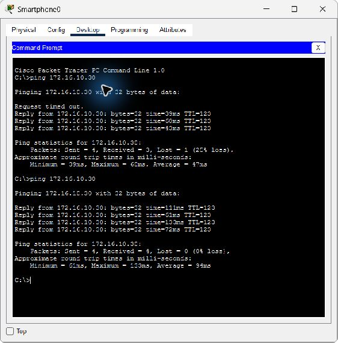 | 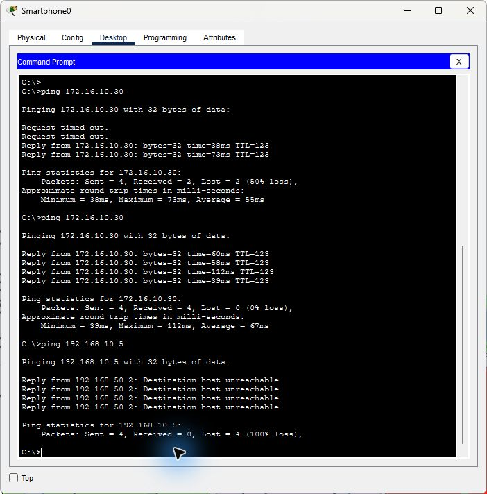 |
| **T001:** Guest→externo, segunda serie completa. | **T002:** Guest→Internal Server, destino no alcanzado. |

**Fig. 6.** Contraste entre disponibilidad del servicio externo y restricción hacia recursos internos desde Guest Wi-Fi. Las imágenes son evidencia primaria preservada por hash; el manifest correspondiente conserva origen, destino, timestamp y contexto.

## 4. La WLAN corporativa no equivale a confianza interna

T006–T008 producen uno de los resultados más relevantes para la pregunta de investigación. El cliente asociado al SSID corporativo 'wifi', observado con WPA2-PSK/AES y dirección 192.168.40.25/24, alcanzó el host externo en T006. Sin embargo, T007 no alcanzó Internal Server y T008 no alcanzó Management.

La consecuencia analítica es distinta de afirmar simplemente que “la WLAN privada es segura”. El baseline implementa VLAN40 como una zona de movilidad corporativa restringida. Su condición de red privada/corporativa no le concede automáticamente acceso a recursos internos. La política de segmentación continúa imponiendo límites.

Este resultado es consistente con la hipótesis establecida en el primer avance: la exposición efectiva depende de la combinación de controles y no únicamente de la etiqueta pública o privada. En el mismo escenario, tanto Guest como Corp Wi-Fi utilizan WPA2-PSK/AES, pero la capacidad de alcanzar zonas internas está determinada adicionalmente por VLAN, ACL, rutas y servicios. Esto muestra por qué la autenticación del enlace y la autorización dentro de la red deben analizarse como capas diferentes.

La literatura ya advertía que el contexto de la WLAN no debe convertirse en una categoría absoluta de seguridad. Schmitt et al. cuestionan la caracterización automática de Wi-Fi público como inherentemente inseguro bajo protecciones modernas [1], mientras que NIST trata la seguridad WLAN como un problema de política, configuración, mantenimiento y monitoreo [3]. Los resultados del laboratorio no prueban la tesis completa de esos trabajos, pero sí muestran en el caso simulado que la distinción “pública/privada” no predice por sí sola los permisos internos.

| Control positivo | Restricción interna |
|---|---|
| 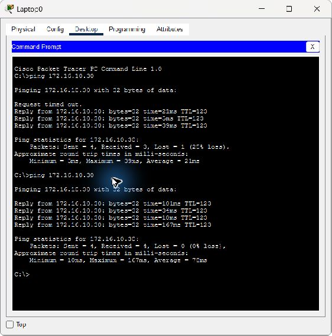 | 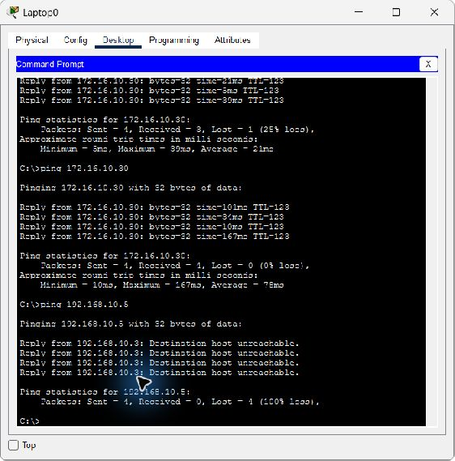 |
| **T006:** Corp Wi-Fi→externo, segunda serie completa. | **T007:** Corp Wi-Fi→Internal Server, resultado deny. |

**Fig. 7.** La WLAN corporativa mantiene conectividad externa, pero no obtiene confianza interna automática.

## 5. Plano de administración: selectividad comprobada y una pregunta no resuelta

El plano administrativo muestra un patrón parcialmente verificado. T009 confirmó que el host de Management 192.168.60.8 pudo abrir el servicio HTTPS representado por el WLC 192.168.70.5. T014 probó el mismo destino y servicio desde Guest Wi-Fi y terminó en Request Timeout. Esta comparación es más informativa que cualquiera de las pruebas por separado porque mantiene el destino constante y cambia la zona de origen.

El hallazgo demuestra selectividad del acceso al servicio representado del WLC: un origen administrativo pudo alcanzarlo y un origen Guest no completó el intercambio. No demuestra, sin embargo, que el WLC utilice autenticación robusta, certificados válidos o TLS criptográficamente seguro. Packet Tracer representa el servicio; no reproduce todas las propiedades de una implementación real.

T010 obliga a mantener una segunda distinción. El plan esperaba evaluar Management→RADIUS mediante SSH, pero el servidor RADIUS no exponía un servicio/cuenta SSH verificable. Ejecutar un ping como sustituto habría cambiado la pregunta y fabricar credenciales habría contaminado el baseline. Por eso T010 permanece indeterminado. Lejos de ser un “dato faltante” que deba ocultarse, documenta una propiedad importante de una metodología rigurosa: un instrumento inválido para el servicio real no puede transformarse en evidencia de allow o deny.

| Origen autorizado | Origen Guest |
|---|---|
| 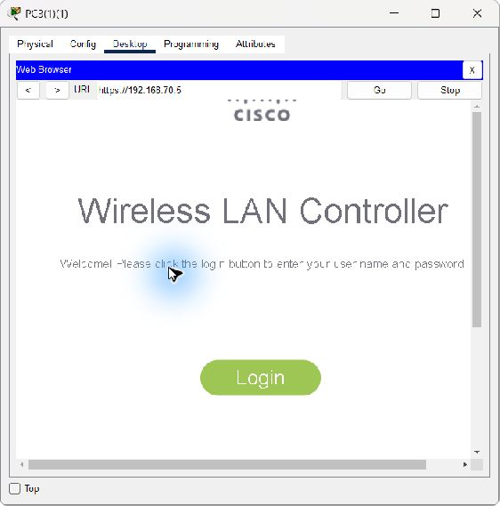 | 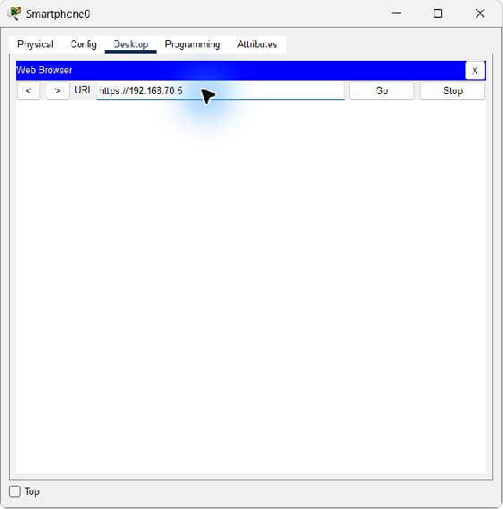 |
| **T009:** Management→WLC HTTPS responde. | **T014:** Guest→WLC HTTPS no completa intercambio. |

**Fig. 8.** Selectividad del acceso al WLC según zona de origen. El resultado no valida autenticación ni TLS real.

## 6. Separación entre personal operativo y administración

T011–T013 permiten observar que Hospitalstaff no funciona como una zona administrativa. T013 alcanzó Internal Server con respuestas estables, mientras T011 no completó intercambio ICMP con RADIUS y T012 no completó intercambio con Management.

La combinación tiene dos implicaciones. Primero, T013 demuestra que el origen VLAN30 posee conectividad funcional hacia un recurso coherente con su rol, por lo que T011/T012 no deben interpretarse como una desconexión general. Segundo, la política diferencia “personal del hospital” de “administrador de infraestructura”. Esto es una aplicación directa del principio de mínimo privilegio a nivel de arquitectura de red: pertenecer a una zona interna no implica acceso indiscriminado a servicios de autenticación o administración.

T012 requiere cautela adicional. El timeout es una observación válida de ausencia de intercambio ICMP exitoso, pero la ACL de Management puede afectar el retorno. Sin una traza PDU fiable no puede afirmarse que la solicitud nunca llegó al destino. El hallazgo útil es que la comunicación bidireccional no se completó; la causa exacta permanece possible.

## 7. Qué aporta la comparación P–C–O

Uno de los resultados metodológicos más importantes es que cuatro flujos permitidos fueron observables aunque C permaneciera unknown: T001, T006, T009 y T013. Esto no reduce la calidad de la campaña. Al contrario, demuestra por qué la inspección de ACL no sustituye una validación activa.

Una ACL puede indicar que cierto tráfico no está explícitamente bloqueado, pero la conectividad completa depende también de routing, estado del servicio, ASA/NAT, gateways y retorno. Por eso el diseño congeló C antes de ejecutar y evitó “completar” retroactivamente la predicción después de conocer O.

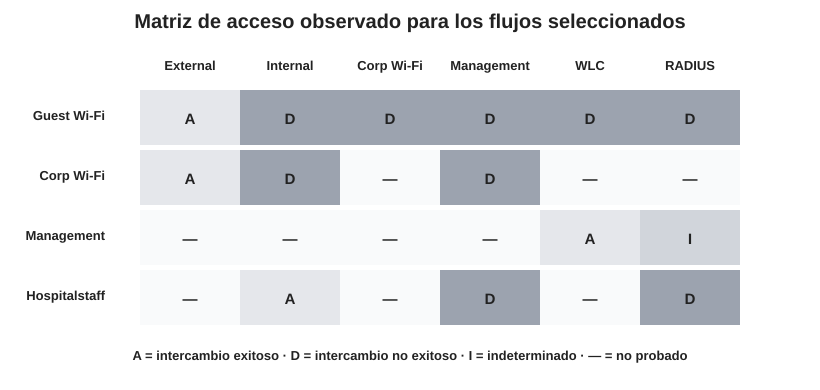

**Fig. 9.** Matriz de los flujos efectivamente observados. Las celdas vacías no representan allow ni deny: son comunicaciones no incluidas en la campaña.

El 69,23 % de conformidad estricta no significa que el resto “falló”. Nueve casos poseen P=C=O; cuatro casos válidos poseen P=O y C desconocida; solo T010 es inválido para medir el flujo planeado. En los trece casos válidos, el comportamiento observado coincide con la política definida previamente.

Esta diferencia entre **conformidad estricta** y **acuerdo con política** debe conservarse en el documento final porque evita convertir una métrica metodológica en una falsa medida de seguridad.

## 8. Fuerza de la evidencia y causalidad

CP4 revisó no solo si un resultado ocurrió, sino cuánta evidencia existe para atribuirlo a un mecanismo concreto.

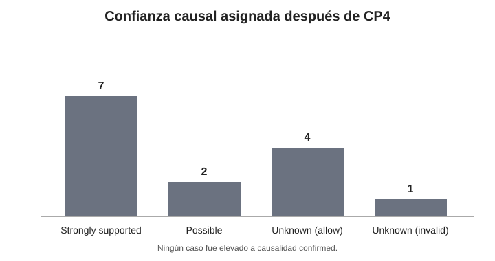

**Fig. 10.** Confianza causal asignada después del audit CP4. Ningún caso fue elevado a confirmed.

Siete casos deny tienen causalidad strongly_supported porque combinan observación, controles positivos, rutas y ACL coherentes. T012 y T014 mantienen causalidad possible. Los cuatro casos allow válidos tienen causalidad unknown porque demostrar que una comunicación funciona no identifica por sí solo cuál componente “permitió” el flujo. T010 también es unknown, pero además inválido para el propósito previsto.

Esta clasificación permite redactar con precisión: se puede afirmar que un flujo fue observado como allow o deny; en varios casos se puede indicar que la ACL es una explicación fuertemente respaldada; no se debe afirmar que una regla específica produjo el descarte si esa relación no fue observada directamente.

## 9. Deriva entre documentación y configuración viva

El running-config capturado durante CP3 reveló diferencias con los fragmentos TXT utilizados en la preparación. Entre ellas se encuentran permisos RADIUS UDP 1812/1813, un permiso asociado al host de Management 192.168.60.8, respuestas DHCP en ACL wifi/guestwifi y diferencias en la terminación de la ACL wifi entre MLS0 y MLS1.

Este hallazgo no significa automáticamente que exista una vulnerabilidad explotable. Su importancia es de gobernanza. Si el repositorio documental y el estado vivo divergen, un analista puede tomar decisiones utilizando una representación incompleta de la red. En nuestro propio experimento esa diferencia explica por qué era correcto validar C con el estado observado y no asumir que los fragmentos eran running-config completos.

NIST recomienda estandarizar, automatizar y centralizar la implementación y mantenimiento de configuración WLAN para detectar y corregir cambios no autorizados [3]. La campaña proporciona una justificación concreta para esa recomendación dentro del caso: la configuración debe tratarse como evidencia versionada, no como texto estático de referencia.

## 10. Contraste con la hipótesis del primer avance

La hipótesis planteaba que la exposición efectiva depende más de la combinación de autenticación, configuración, segmentación, endpoint, comportamiento del usuario y protección de aplicación que de la clasificación pública/privada considerada aisladamente.

Los resultados apoyan **parcialmente** esa hipótesis, dentro del alcance que Packet Tracer puede observar.

La parte respaldada experimentalmente es la relacionada con configuración, segmentación y control de flujo. Guest Wi-Fi no quedó “insegura” por ser pública: conservó conectividad externa y fue restringida hacia los recursos seleccionados. Corp Wi-Fi no quedó “segura” o privilegiada por ser privada: mantuvo acceso externo, pero siguió aislada de Internal Server y Management.

La parte que no puede declararse comprobada corresponde a endpoint, asociación, ataques Evil Twin, cifrado real de aplicación, validación TLS y comportamiento humano. Esas capas permanecen sustentadas por la literatura. Chatzisofroniou y Kotzanikolaou muestran que las decisiones de asociación y validación del cliente siguen siendo relevantes [7]; Beer et al. muestran que las aplicaciones pueden reintroducir tráfico HTTP incluso en un ecosistema dominado por HTTPS [9]; Sombatruang et al. muestran que el comportamiento del usuario frente a Wi-Fi no se explica solamente por percepción de riesgo [12].

La interpretación correcta es, por tanto, que la campaña **corrobora la importancia de la segmentación y del control de acceso dentro del modelo multicapa**, pero no pretende validar experimentalmente todas las capas de la hipótesis.

## 11. Propuesta de solución

La propuesta no consiste en reconstruir la red. Los resultados muestran varios controles que ya funcionan y deben preservarse. La solución se organiza en cuatro líneas.

### 11.1 Preservar la separación funcional

Guest Wi-Fi debe conservar salida externa y aislamiento de las zonas internas evaluadas. VLAN40 debe documentarse como movilidad corporativa restringida. Si el Centro Médico Horizonte CR necesitara una WLAN clínica con acceso a servicios internos, la opción más controlable sería crear un SSID/VLAN específico con privilegios mínimos y pruebas propias, en vez de ampliar de forma general los permisos de VLAN40.

### 11.2 Fortalecer autenticación sin confundirla con autorización

El baseline observado usa WPA2-PSK/AES tanto en Guest como en Corp Wi-Fi. La segmentación reduce el impacto de una credencial compartida, pero no resuelve la identidad individual. Para un despliegue real, la WLAN corporativa debería evaluar autenticación individual mediante 802.1X/EAP y RADIUS, con validación correcta de la infraestructura, y WPA3 donde exista compatibilidad. Esta mejora se sustenta en la literatura y en la necesidad de separar credenciales por usuario; no se presenta como control probado por CP3 [2], [3], [7].

### 11.3 Convertir configuración y pruebas en controles operativos

El running-config observado debe capturarse y versionarse antes de pruebas o cambios. Un diff automático contra la documentación debe tratar las divergencias no explicadas como condición de revisión. La matriz P–C–O y los catorce casos pueden conservarse como suite de regresión después de modificaciones de ACL, WLC, routing o servicios.

Esto convierte el trabajo académico en un mecanismo operativo: un cambio de red puede verificarse mediante la misma relación policy → configuration → observed, conservando evidencia before/after.

### 11.4 Completar las capas fuera del simulador

La arquitectura lógica no elimina ataques de asociación, endpoints desactualizados ni aplicaciones inseguras. Por ello, un despliegue real debe complementar la segmentación con validación de certificados, controles de auto-asociación, actualización de dispositivos, HTTPS/TLS, monitoreo WLAN y detección de puntos de acceso no autorizados [1], [3], [7], [9].

## 12. Matriz de propuesta

| Control | Qué resuelve | Base de evidencia | Estado |
|---|---|---|---|
| C01 Mantener aislamiento Guest | Exposición de visitantes a redes internas | T001–T005, T014 | Preservar |
| C02 Formalizar Corp Wi-Fi restringida | Confianza excesiva por etiqueta “privada” | T006–T008 | Preservar/documentar |
| C03 802.1X/EAP-RADIUS para corporativa | Dependencia de PSK compartida | Preflight + literatura [2], [3], [7] | Mejora fuera de CP3 |
| C04 Matriz explícita de servicios administrativos | Ambigüedad WLC/RADIUS | T009, T010, T014 | Implementar |
| C05 Config-as-evidence + diff | Deriva TXT/running-config | F06 + [3] | Implementar |
| C06 Suite P–C–O de regresión | Validación post-cambio | F05 | Implementar |
| C07 Endpoint/TLS/WLAN monitoring | Riesgos no simulados | Literatura [1], [3], [7], [9], [12] | Validación separada |

## 13. Limitaciones que deben permanecer visibles

1. La copia runtime guardada no es binariamente idéntica al PKT original. El usuario indicó que la guardó sin modificar configuración; se conservaron ambos hashes y la copia. Esto limita la procedencia estricta, aunque no se modificaron los originales.
2. T010 no produce una conclusión sobre SSH/RADIUS.
3. T012 y T014 no identifican con certeza el punto exacto de descarte.
4. Los tests cubren flujos seleccionados, no todos los protocolos o destinos.
5. Packet Tracer representa una arquitectura lógica; no valida RF, WPA3 real, OWE, certificados, TLS real, Evil Twin ni comportamiento de sistemas operativos actuales.
6. El caso es hipotético y los resultados no constituyen una muestra estadística de hospitales reales.

## 14. Trazabilidad y anexos

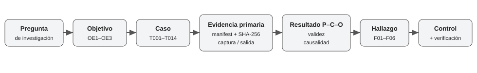

**Fig. 11.** Cadena de trazabilidad utilizada para pasar de la pregunta de investigación a una propuesta de control.

Para evitar saturar el artículo con data dura, el cuerpo debe usar tablas de síntesis y evidencia visual representativa. Los datos completos permanecen accesibles mediante anexos:

- **Anexo A:** matriz completa T001–T014 y P–C–O.
- **Anexo B:** índice de manifests, screenshots y salidas primarias.
- **Anexo C:** evidencia de configuración y diferencias TXT/running-config.
- **Anexo D:** hashes, procedencia y validadores.
- **Anexo E:** mapping objetivo → variable → prueba → evidencia → hallazgo → control.

Ver 'docs/advance2/ANNEX_INDEX.md'.

## 15. Referencias utilizadas en la discusión

La numeración continúa la bibliografía del primer avance. Para CP5 son particularmente relevantes [1] Schmitt et al.; [2] Veroni et al.; [3] NIST SP 800-153; [6] el repositorio técnico base; [7] Chatzisofroniou y Kotzanikolaou; [9] Beer et al.; [12] Sombatruang et al.; y [13] Cisco Packet Tracer Data Sheet incorporada en el marco metodológico.
